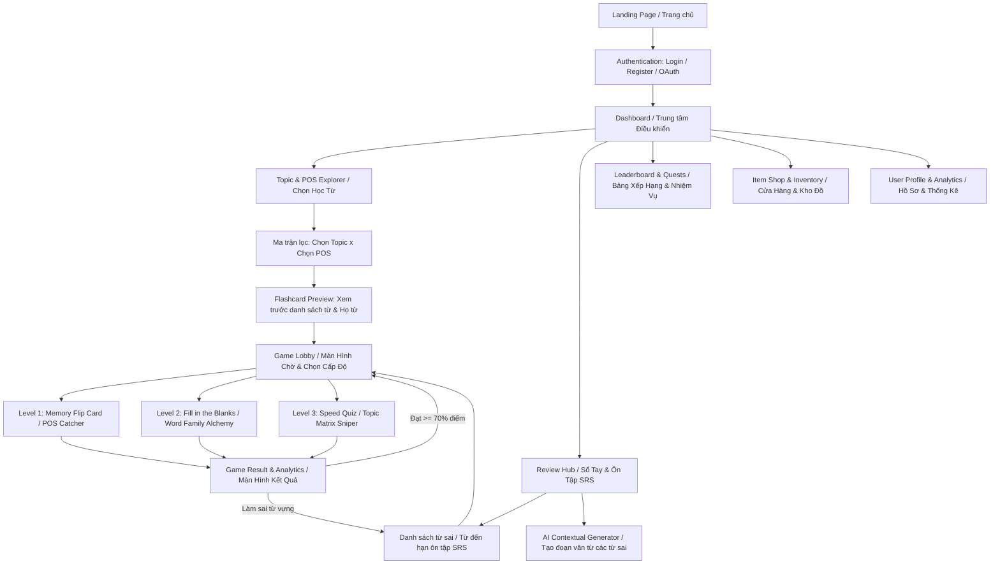
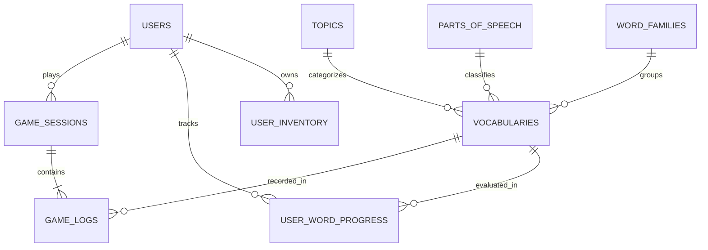

# TÀI LIỆU PHÂN TÍCH HỆ THỐNG & ĐẶC TẢ KỸ THUẬT: DỰ ÁN VOCABQUEST
**Phiên bản:** 1.0.0  
**Mô hình:** Nền tảng Web học từ vựng tiếng Anh qua Trò chơi hóa (Gamified EdTech)  
**Đặc trưng cốt lõi:** Phân loại ma trận 2 chiều (Chủ đề x Loại từ) kết hợp Hệ thống Họ từ (Word Families) và Lặp lại ngắt quãng (SRS).

---

## PHẦN 1: Đề xuất Sáng tạo thêm Trò chơi & Tính năng Đột phá

### 1. Đề xuất 3 Mini-games Mới (Khai thác sâu Loại từ & Chủ đề)

*   **Game 4 (Cấp độ 1.5 - Nhận diện & Phân loại): POS Catcher (Rổ Hứng Từ Loại)**
    *   **Đặc thù:** Khai thác trực diện hậu tố nhận biết loại từ (Suffixes: `-tion`, `-ment` cho Danh từ; `-able`, `-ive` cho Tính từ; `-ly` cho Trạng từ...).
    *   **Cơ chế:** Các đám mây từ vựng thuộc cùng một Chủ đề rơi từ đỉnh màn hình xuống với tốc độ tăng dần. Ở đáy màn hình là 4 rổ phân loại cố định hoặc người dùng điều khiển 1 giỏ chuyển đổi trạng thái giữa: `[Noun]`, `[Verb]`, `[Adjective]`, `[Adverb]`. Người chơi phải hứng đúng từ vào rổ loại từ tương ứng hoặc gạt từ sang làn đường tương ứng.
*   **Game 5 (Cấp độ 2.5 - Biến đổi Cấu trúc): Word Family Alchemy (Giả Kim Thuật Họ Từ)**
    *   **Đặc thù:** Khai thác triệt để hệ thống `Word Families` (Họ từ) kết hợp ngữ cảnh câu.
    *   **Cơ chế:** Màn hình hiển thị một câu khuyết 1 vị trí (đã gợi ý ngầm bằng cấu trúc ngữ pháp của câu) và cung cấp 1 **Từ gốc (Root Word)** nằm trong vạc giả kim (Ví dụ: gốc `CREATE`). Người chơi phải chọn đúng "Đá phép" (Tiền tố/Hậu tố: `-ion`, `-ive`, `-ively`, `-or`, `re-`) ném vào vạc để biến đổi từ gốc thành loại từ phù hợp nhất với vị trí khuyết trong câu (Ví dụ: Cần trạng từ đứng trước động từ thường -> ghép thành `creatively`).
*   **Game 6 (Cấp độ 3.5 - Phản xạ Ngữ cảnh & Chủ đề): Topic Matrix / Syntax Sniper (Bắn Tỉa Ngữ Cảnh & Chủ Đề)**
    *   **Đặc thù:** Kết hợp đồng thời 2 chiều dữ liệu: **Chủ đề (Topic)** và **Loại từ (POS)** kèm theo âm thanh (Audio).
    *   **Cơ chế:** Trên màn hình xuất hiện các bia mục tiêu di chuyển chứa các từ vựng. Hệ thống phát lệnh săn mục tiêu theo tổ hợp điều kiện kép hoặc phát Audio phát âm. Ví dụ lệnh: *"Bắn tất cả **Tính từ (Adjectives)** thuộc chủ đề **Công nghệ (Technology)**!"* hoặc *"Nghe phát âm và bắn vào **Danh từ** đồng nghĩa!"*. Người chơi phải phản xạ nhanh để bắn trúng từ thỏa mãn cả 2 điều kiện và tránh các từ gây nhiễu (khác loại từ hoặc lạc chủ đề).

### 2. Đề xuất 3 Tính năng Thông minh (AI / EdTech)

*   **Thuật toán Spaced Repetition kết hợp Trọng số Loại từ (POS-Weighted SM-2 SRS):**
    *   **Cơ chế:** Nâng cấp thuật toán SuperMemo-2 (SM-2). Không chỉ tính toán thời gian ôn tập dựa trên việc nhớ hay quên một từ đơn lẻ, hệ thống còn theo dõi **Tỷ lệ sai theo Loại từ (POS Error Rate)**. Nếu người dùng liên tục làm sai các câu hỏi liên quan đến *Adverb (Trạng từ)* ở Cấp độ 2, thuật toán sẽ tự động giảm `Interval` (chu kỳ lặp lại) của các từ thuộc nhóm Adverb và ưu tiên sinh bài tập biến đổi Họ từ (`Adj` -> `Adv`) trong các phiên ôn tập kế tiếp.
*   **AI Contextual Story & Sentence Generator (Tạo ngữ cảnh cá nhân hóa bằng LLM):**
    *   **Cơ chế:** Tích hợp API LLM (Gemini API / OpenAI API). Khi người dùng có danh sách 5–10 từ hay làm sai trong "Sổ tay ôn tập", hệ thống cho phép bấm nút **"Tạo Truyện Ngắn Ôn Tập"**. AI sẽ lấy danh sách từ đó, kết hợp với Chủ đề yêu thích của người dùng, tự động sinh ra một đoạn hội thoại hoặc đoạn văn ngắn (100-150 từ) chứa toàn bộ các từ mục tiêu được in đậm theo đúng Loại từ chuẩn xác, kèm bản dịch và giải thích ngữ pháp tại chỗ.
*   **Hệ thống RPG Gamification: Trang bị Ngữ Pháp (Grammar Relics) & Cửa hàng Vật phẩm (Item Shop):**
    *   **Cơ chế:** Người chơi nhận `Coins` và `XP` sau mỗi màn chơi để mua vật phẩm bổ trợ:
        *   *Streak Freeze (Đóng băng chuỗi):* Bảo vệ chuỗi ngày học nếu quên đăng nhập 1 ngày.
        *   *POS Hint Compass (La bàn Loại từ):* Trong game Cấp độ 2 & 3, kích hoạt để làm sáng dấu hiệu ngữ pháp trong câu (ví dụ: tô sáng mạo từ `a/an/the` đứng trước chỗ trống để báo hiệu cần điền `Noun` hoặc `Adj`).
        *   *Time Dilator (Làm chậm thời gian):* Giảm 30% tốc độ rơi của chữ hoặc cộng thêm 10 giây ở Cấp độ 3.

---

## PHẦN 2: Phân tích Luồng Người Dùng (User Flow) & Sơ đồ Trang (Sitemap)

### 1. Sơ đồ Cấu trúc Trang (Sitemap)



### 2. Chi tiết Luồng Người Dùng Chính (Core User Flow)

```text
[1. Đăng nhập] 
   │
   ▼
[2. Dashboard] ──(Kiểm tra Streak & Nhiệm vụ ngày)
   │
   ├──► Nhánh A (Có từ đến hạn SRS): Hệ thống nổi thông báo đỏ "Cần ôn tập X từ" ──► Chuyển thẳng vào [Chế độ Ôn tập]
   │
   └──► Nhánh B (Học mới): Vào [Topic & POS Explorer]
           │
           ▼
[3. Chọn Bộ Từ] ──► Chọn Chủ đề (VD: "Công nghệ") + Chọn Bộ lọc Loại từ (VD: "Tất cả" hoặc chỉ "Động từ & Danh từ")
           │
           ▼
[4. Xem trước (Preview)] ──► Lướt nhanh 10 từ mục tiêu (Nghe audio, xem họ từ Word Family) ──► Bấm "Bắt đầu Thử thách"
           │
           ▼
[5. Vượt Cấp Độ Game (Progression Gate)]
   ├──► [Chơi Cấp độ 1: Nhận diện] (Memory Flip / POS Catcher)
   │       ├─ Nếu Điểm < 70% hoặc Hết máu (HP = 0): Thất bại ──► Chơi lại Cấp 1 (Lưu từ sai vào Sổ tay).
   │       └─ Nếu Điểm >= 70%: Mở khóa Cấp độ 2.
   │
   ├──► [Chơi Cấp độ 2: Cấu trúc] (Fill in the Blanks / Word Family Alchemy)
   │       ├─ Nếu Sai 1 câu: Trừ 1 HP + Hiện Popup Giải thích Ngữ pháp Loại từ (2 giây) + Ghi nhận lỗi sai.
   │       └─ Nếu Điểm >= 75%: Mở khóa Cấp độ 3.
   │
   └──► [Chơi Cấp độ 3: Phản xạ] (Speed Quiz / Word Scramble / Topic Matrix)
           └─ Hoàn thành dưới áp lực thời gian ──► Tính tổng điểm toàn phiên.
           │
           ▼
[6. Xử lý Kết quả & Đồng bộ Backend (Post-Game Processing)]
   ├──► Cộng XP, nâng Level user, cộng Coins, cập nhật Streak (nếu là ván đầu tiên trong ngày).
   ├──► Cập nhật bảng `UserWordProgress`:
   │       ├─ Từ trả lời đúng 100% qua 3 cấp: Tăng bậc SRS (`Repetitions + 1`, tính `NextReviewDate` xa hơn).
   │       └─ Từ trả lời sai >= 1 lần: Reset bậc SRS (`Repetitions = 0`, `NextReviewDate = NOW()`), đẩy vào "Sổ tay từ sai".
   └──► Cập nhật điểm lên Redis Leaderboard (Tuần/Tháng).
```

---

## PHẦN 3: Đặc tả Cơ chế Trò chơi (Game Mechanics Breakdown)

| Tên Game & Cấp độ | Dữ liệu đầu vào (Input Data từ DB) | Luật chơi & Thao tác người dùng (UI/UX Interaction) | Công thức tính điểm, Thời gian, Combo & Điều kiện qua màn | Xử lý khi người dùng chọn sai (Error Handling & EdTech Feedback) |
| :--- | :--- | :--- | :--- | :--- |
| **1. Memory Flip Card**<br>*(Cấp độ 1 - Nhận diện)* | Mảng `8` hoặc `10` object từ vựng:<br>`{ id, word, phonetic, audio_url, meaning_vi, image_url, pos_tag, pos_color }` | - Lưới 4x4 (16 thẻ) hoặc 4x5 (20 thẻ) úp mặt.<br>- Chia làm 2 nhóm thẻ: Thẻ Từ (`word` + `phonetic` + `audio`) và Thẻ Nghĩa (`meaning_vi` + `image` + nhãn `pos_tag`).<br>- Click lật tối đa 2 thẻ/lượt. Khi lật thẻ Từ, tự động phát `audio_url`.<br>- Viền thẻ khi lật lên có màu tương ứng với Loại từ (`pos_color`). | - **Base Score:** `100 điểm` / cặp đúng.<br>- **Timer:** `90 giây` đếm ngược.<br>- **Combo:** Lật đúng liên tiếp không sai lượt nào: `Điểm = 100 * (1 + 0.2 * ComboCount)`.<br>- **Bonus thời gian:** `+5 điểm` cho mỗi giây dư.<br>- **Qua màn:** Ghép hết các cặp trước khi hết giờ và số lần lật sai <= 12 lần. | - Hai thẻ rung lắc (Shake animation), phát âm thanh báo sai, tự úp lại sau `800ms`.<br>- Reset `ComboCount = 0`.<br>- Nếu 1 từ bị lật lên mà ghép sai quá `3 lần`, đánh dấu `is_struggling = true` và đẩy vào danh sách cần lưu ý sau màn chơi. |
| **2. POS Catcher (Rổ Hứng Từ Loại)**<br>*(Cấp độ 1.5 - Phân loại)* | Mảng `15-20` từ vựng:<br>`{ id, word, pos_tag, meaning_vi, suffix_highlight }` | - Màn hình chia 4 làn dọc tương ứng 4 rổ ở đáy: `Noun` (Xanh dương), `Verb` (Đỏ), `Adj` (Xanh lá), `Adv` (Tím).<br>- Các viên ngọc chứa `word` rơi từ trên xuống. Người dùng bấm phím `1, 2, 3, 4` hoặc kéo/chạm để chuyển từ vào đúng làn rổ loại từ của nó trước khi chạm đất. | - **Base Score:** `50 điểm` / từ hứng đúng.<br>- **Timer:** `60 giây` (Tốc độ rơi tăng thêm `15%` sau mỗi 15 giây).<br>- **Combo:** Chuỗi 5 từ đúng liên tiếp kích hoạt *Fever Mode* (`x2 điểm`).<br>- **Máu (HP):** `5 tim`.<br>- **Qua màn:** Sống sót hết 60s hoặc hứng xong 20 từ với HP > 0 và độ chính xác >= 70%. | - Trừ `1 HP`, màn hình chớp đỏ nhẹ, reset Combo.<br>- Hiển thị **Toast Giải thích nhanh** ở góc màn hình (không dừng game): *"Cẩn thận! **Creation** có đuôi **-tion** là **Danh từ (Noun)**!"*.<br>- Đẩy `vocab_id` vào mảng `wrong_words[]` để lưu vào Sổ tay. |
| **3. Fill in the Blanks**<br>*(Cấp độ 2 - Cấu trúc)* | Mảng `10` câu hỏi:<br>`{ vocab_id, word, pos_tag, cloze_sentence, grammar_hint, distractors[3] }` | - Hiển thị câu ví dụ có chỗ trống `[___]` (Ví dụ: *"She spoke very [___] at the meeting."*).<br>- Chế độ 2A (Trắc nghiệm 4 đáp án cùng Họ từ: *confident, confidence, confidently, confide*) hoặc Chế độ 2B (Gõ các chữ cái còn khuyết: `c _ n f _ d e n t l y`). | - **Base Score:** `150 điểm` / câu.<br>- **Timer:** `15 giây` / câu.<br>- **Speed Bonus:** Trả lời trong <= 5s cộng thêm `50 điểm`.<br>- **Combo:** `+30 điểm` lũy tiến cho mỗi câu đúng liên tiếp.<br>- **Máu (HP):** `3 tim`.<br>- **Qua màn:** Hoàn thành 10 câu với HP > 0 và đạt tối thiểu `8/10` câu đúng. | - Trừ `1 HP`, khóa nút chọn, **Tạm dừng Timer**.<br>- Bật **Modal Ngữ Pháp (Grammar Breakdown)**: Tô sáng từ đứng trước/sau chỗ trống (VD: tô sáng động từ `spoke`) và hiển thị `grammar_hint`: *"Sau động từ thường (spoke) cần một **Trạng từ (Adverb)** để bổ nghĩa cho hành động -> Chọn **confidently**."*<br>- Người dùng phải bấm nút `"Đã hiểu"` để sang câu tiếp theo. Đẩy từ vào Sổ tay từ sai. |
| **4. Word Family Alchemy**<br>*(Cấp độ 2.5 - Họ từ)* | Mảng `10` bài toán biến đổi:<br>`{ root_word, target_word, target_pos, affix_options[], cloze_sentence, grammar_explanation }` | - Giữa màn hình là Vạc Giả Kim chứa `root_word` (VD: `DEPEND`) và câu ngữ cảnh cần điền từ.<br>- Xung quanh là các viên đá Tiền tố/Hậu tố (`in-`, `-ent`, `-ence`, `-ently`, `-able`).<br>- Người chơi kéo thả (Drag & Drop) các viên đá vào vạc theo đúng thứ tự để rèn thành từ hoàn chỉnh khớp với câu (VD: `in-` + `depend` + `-ently` -> `independently`). | - **Base Score:** `200 điểm` / lần rèn thành công.<br>- **Timer:** `20 giây` / câu.<br>- **Combo:** Rèn đúng ngay lần thử đầu tiên: `x1.5 điểm`.<br>- **Máu (HP):** `3 tim`.<br>- **Qua màn:** Rèn thành công ít nhất `7/10` từ trước khi hết máu. | - Vạc giả kim bốc khói đen (hiệu ứng nổ nhẹ), trừ `1 HP`.<br>- Hiển thị công thức đúng: `Root + Suffix = Target Word (POS)` kèm nghĩa tiếng Việt của cả họ từ để người chơi phân biệt.<br>- Tự động đánh dấu cả họ từ đó vào danh sách ưu tiên ôn tập SRS. |
| **5. Speed Quiz & Word Scramble**<br>*(Cấp độ 3 - Phản xạ)* | Mảng `15` thử thách hỗn hợp:<br>`{ vocab_id, word, synonyms[], antonyms[], scrambled_words[], audio_url }` | - Kết hợp xen kẽ 2 dạng câu hỏi tốc độ cao:<br>  + *Dạng A (Syn/Ant):* Cho từ gốc + Nhãn yêu cầu (`ĐỒNG NGHĨA` màu xanh hoặc `TRÁI NGHĨA` màu cam). Chọn 1 trong 4 đáp án cực nhanh.<br>  + *Dạng B (Scramble):* Sắp xếp các mảnh từ bị xáo trộn thành câu hoàn chỉnh chứa từ vựng mục tiêu. | - **Base Score:** `250 điểm` / câu.<br>- **Timer:** Thanh thời gian tổng `60 giây` (Trả lời đúng cộng thêm `+3 giây`, trả lời sai trừ `-5 giây`).<br>- **Combo:** Đạt chuỗi 5 câu đúng liên tiếp kích hoạt `x2.5 điểm`.<br>- **Qua màn:** Vượt qua mốc điểm mục tiêu (VD: `2500 điểm`) trước khi thanh thời gian về `0`. | - Phạt `-5 giây` trực tiếp trên thanh thời gian (thanh thời gian nháy đỏ).<br>- Hiển thị đáp án đúng trong `1.2 giây` kèm phát âm chuẩn rồi chuyển câu ngay lập tức để giữ nhịp độ cao.<br>- Cuối màn tổng hợp toàn bộ các câu sai ở bảng phân tích chi tiết. |
| **6. Topic Matrix Sniper**<br>*(Cấp độ 3.5 - Tổng hợp)* | Mảng `25` từ (gồm `15` từ đúng điều kiện và `10` từ nhiễu khác Topic hoặc khác POS):<br>`{ id, word, topic_id, pos_tag, audio_url }` | - Màn hình hiển thị lưới 3x3 hoặc các bong bóng từ nổi lên liên tục.<br>- Trên đỉnh màn hình là **Lệnh Săn Mục Tiêu** thay đổi sau mỗi 15 giây (VD: *"Bắn tất cả ĐỘNG TỪ thuộc chủ đề CÔNG SỞ"*).<br>- Người chơi click (bắn) vào các từ thỏa mãn đồng thời cả `Topic` và `POS`. Bỏ qua các từ gây nhiễu. | - **Base Score:** `+100 điểm` / mục tiêu đúng.<br>- **Phạt bắn nhầm:** `-50 điểm` và trừ `1 HP`.<br>- **Timer:** `60 giây`.<br>- **Máu (HP):** `3 tim`.<br>- **Qua màn:** Tiêu diệt >= 80% mục tiêu đúng và còn ít nhất `1 HP`. | - Khi bắn nhầm vào từ nhiễu: Hiện nhãn phân tích ngay tại vị trí bắn (VD: *"Sai! **Flight** là **Danh từ** (Du lịch), không phải **Động từ** (Công sở)!"*).<br>- Đưa từ bị nhầm lẫn vào danh sách ôn tập phân biệt từ loại. |

---

## PHẦN 4: Thiết kế Cơ sở Dữ liệu (Database Schema / ERD)

Thiết kế dưới đây chuẩn hóa cho Hệ quản trị CSDL Quan hệ (**PostgreSQL**) hoặc có thể ánh xạ tương đương sang **MongoDB** (sử dụng Reference & Embedded Document cho `word_families` và `examples`).

### Sơ đồ Quan hệ Thực thể (ERD)



### Chi tiết Cấu trúc các Bảng (Tables Specification)

#### 1. Bảng `users` (Quản lý người dùng & Gamification)
| Tên trường (Field) | Kiểu dữ liệu (Data Type) | Ràng buộc (PK/FK) | Mô tả chi tiết |
| :--- | :--- | :--- | :--- |
| `id` | `UUID` | **PK** | Định danh duy nhất của người dùng (UUID v4). |
| `username` | `VARCHAR(50)` | `UNIQUE, NOT NULL` | Tên hiển thị trên Bảng xếp hạng. |
| `email` | `VARCHAR(120)` | `UNIQUE, NOT NULL` | Email đăng nhập. |
| `password_hash` | `VARCHAR(255)` | `NOT NULL` | Mật khẩu mã hóa Bcrypt/Argon2. |
| `avatar_url` | `TEXT` | `NULLABLE` | Đường dẫn ảnh đại diện. |
| `xp` | `INTEGER` | `DEFAULT 0` | Tổng điểm kinh nghiệm tích lũy. |
| `level` | `INTEGER` | `DEFAULT 1` | Cấp độ hiện tại (Tính theo công thức: `Level = floor(sqrt(XP / 100)) + 1`). |
| `coins` | `INTEGER` | `DEFAULT 100` | Tiền tệ trong game dùng để mua vật phẩm bổ trợ. |
| `current_streak` | `INTEGER` | `DEFAULT 0` | Số ngày học liên tiếp hiện tại. |
| `longest_streak` | `INTEGER` | `DEFAULT 0` | Kỷ lục chuỗi ngày học dài nhất. |
| `last_study_date` | `DATE` | `NULLABLE` | Ngày gần nhất hoàn thành ít nhất 1 GameSession (dùng để tính Streak). |
| `streak_freeze_count`| `INTEGER` | `DEFAULT 0` | Số lượng vật phẩm "Đóng băng chuỗi" đang sở hữu. |
| `created_at` | `TIMESTAMPTZ` | `DEFAULT NOW()` | Thời điểm tạo tài khoản. |

#### 2. Bảng `topics` (Chủ đề từ vựng) & `parts_of_speech` (Loại từ)
| Bảng | Tên trường | Kiểu dữ liệu | Ràng buộc | Mô tả chi tiết |
| :--- | :--- | :--- | :--- | :--- |
| **`topics`** | `id` | `SERIAL` | **PK** | ID chủ đề. |
| | `name` | `VARCHAR(100)` | `NOT NULL` | Tên chủ đề (VD: *Business, Travel, Technology, IELTS Academic*). |
| | `slug` | `VARCHAR(100)` | `UNIQUE` | Đường dẫn tĩnh (VD: `business-english`). |
| | `icon_url` | `TEXT` | `NOT NULL` | Icon đại diện chủ đề. |
| | `difficulty_tier`| `SMALLINT` | `DEFAULT 1` | Độ khó của chủ đề (`1`: Cơ bản, `2`: Trung cấp, `3`: Nâng cao). |
| **`parts_of_speech`**| `id` | `SERIAL` | **PK** | ID loại từ. |
| | `code` | `VARCHAR(20)` | `UNIQUE` | Mã loại từ chuẩn: `NOUN`, `VERB`, `ADJ`, `ADV`, `PHRASAL_VERB`. |
| | `name_vi` | `VARCHAR(50)` | `NOT NULL` | Tên tiếng Việt (Danh từ, Động từ, Tính từ, Trạng từ, Cụm động từ). |
| | `color_hex` | `CHAR(7)` | `NOT NULL` | Mã màu nhận diện UI (VD: Noun `#3B82F6`, Verb `#EF4444`, Adj `#10B981`, Adv `#8B5CF6`). |
| | `common_suffixes`| `JSONB` | `NOT NULL` | Mảng các hậu tố đặc trưng (VD: `["-tion", "-ment", "-ness", "-ity"]`). |
| | `grammar_rules` | `TEXT` | `NOT NULL` | Quy tắc vị trí ngữ pháp cốt lõi để hiển thị gợi ý khi user làm sai. |

#### 3. Bảng `word_families` (Nhóm Họ từ) & `vocabularies` (Từ vựng cốt lõi)
| Bảng | Tên trường | Kiểu dữ liệu | Ràng buộc | Mô tả chi tiết |
| :--- | :--- | :--- | :--- | :--- |
| **`word_families`** | `id` | `UUID` | **PK** | ID định danh nhóm họ từ. |
| | `root_word` | `VARCHAR(100)` | `NOT NULL` | Từ gốc đại diện (VD: `act`, `create`, `decide`). |
| | `family_matrix` | `JSONB` | `NOT NULL` | Lưu nhanh cấu trúc họ từ: `{"noun": ["creation", "creator"], "verb": ["create"], "adj": ["creative"], "adv": ["creatively"]}`. |
| **`vocabularies`** | `id` | `UUID` | **PK** | ID từ vựng. |
| | `topic_id` | `INTEGER` | **FK** -> `topics.id` | Chủ đề của từ. |
| | `pos_id` | `INTEGER` | **FK** -> `parts_of_speech.id` | Loại từ của từ này. |
| | `word_family_id` | `UUID` | **FK** -> `word_families.id` | Liên kết tới nhóm họ từ (Nullable nếu từ đơn lập). |
| | `word` | `VARCHAR(100)` | `NOT NULL, INDEX` | Từ tiếng Anh (VD: `creatively`). |
| | `phonetic_ipa` | `VARCHAR(100)` | `NOT NULL` | Phiên âm quốc tế IPA (VD: `/kriˈeɪ.tɪv.li/`). |
| | `audio_url` | `TEXT` | `NOT NULL` | Link file MP3 phát âm chuẩn (US/UK). |
| | `image_url` | `TEXT` | `NULLABLE` | Ảnh minh họa trực quan (dùng cho Game Level 1). |
| | `meaning_vi` | `VARCHAR(255)` | `NOT NULL` | Nghĩa tiếng Việt ngắn gọn, súc tích. |
| | `definition_en` | `TEXT` | `NULLABLE` | Định nghĩa tiếng Anh. |
| | `example_sentence`| `TEXT` | `NOT NULL` | Câu ví dụ hoàn chỉnh (VD: *"She solved the problem creatively."*). |
| | `cloze_sentence` | `TEXT` | `NOT NULL` | Câu khuyết từ dùng cho Level 2 (VD: *"She solved the problem {{blank}}."*). |
| | `grammar_hint` | `TEXT` | `NOT NULL` | Giải thích vì sao vị trí `{{blank}}` trong câu trên lại cần loại từ này. |
| | `affix_breakdown`| `JSONB` | `NULLABLE` | Cấu tạo từ cho Game Giả Kim Thuật (VD: `{"root": "create", "prefix": null, "suffix": "-ively"}`). |
| | `synonyms` | `JSONB` | `DEFAULT '[]'` | Mảng từ đồng nghĩa (VD: `["imaginatively", "inventively"]`). |
| | `antonyms` | `JSONB` | `DEFAULT '[]'` | Mảng từ trái nghĩa (VD: `["unimaginatively"]`). |
| | `cefr_level` | `VARCHAR(5)` | `DEFAULT 'B1'` | Cấp độ từ vựng (`A1`, `A2`, `B1`, `B2`, `C1`, `C2`). |

#### 4. Bảng `game_sessions` (Phiên chơi) & `game_logs` (Chi tiết từng câu trong phiên)
| Bảng | Tên trường | Kiểu dữ liệu | Ràng buộc | Mô tả chi tiết |
| :--- | :--- | :--- | :--- | :--- |
| **`game_sessions`**| `id` | `UUID` | **PK** | ID phiên chơi. |
| | `user_id` | `UUID` | **FK** -> `users.id` | Người chơi. |
| | `topic_id` | `INTEGER` | **FK** -> `topics.id` | Chủ đề đang chơi (Nullable nếu chơi chế độ Ôn tập tổng hợp). |
| | `pos_filter` | `VARCHAR(50)` | `NULLABLE` | Loại từ được lọc trong phiên chơi (VD: `ALL`, `NOUN_ONLY`). |
| | `game_type` | `VARCHAR(30)` | `NOT NULL` | Mã game: `MEMORY_FLIP`, `POS_CATCHER`, `FILL_BLANK`, `ALCHEMY`, `SPEED_QUIZ`, `SNIPER`. |
| | `game_level` | `SMALLINT` | `NOT NULL` | Cấp độ game (`1`, `2`, `3`). |
| | `total_score` | `INTEGER` | `NOT NULL` | Tổng điểm đạt được. |
| | `max_combo` | `INTEGER` | `DEFAULT 0` | Chuỗi combo cao nhất đạt được trong ván. |
| | `accuracy_rate` | `DECIMAL(5,2)` | `NOT NULL` | Tỷ lệ chính xác (`0.00` đến `100.00` %). |
| | `duration_sec` | `INTEGER` | `NOT NULL` | Thời gian hoàn thành (tính bằng giây). |
| | `is_passed` | `BOOLEAN` | `NOT NULL` | Trạng thái qua màn (`true` / `false`). |
| | `created_at` | `TIMESTAMPTZ` | `DEFAULT NOW()` | Thời điểm kết thúc ván chơi. |
| **`game_logs`** | `id` | `BIGSERIAL` | **PK** | ID bản ghi log chi tiết. |
| | `session_id` | `UUID` | **FK** -> `game_sessions.id`| Thuộc phiên chơi nào. |
| | `vocab_id` | `UUID` | **FK** -> `vocabularies.id` | Từ vựng được hỏi trong lượt đó. |
| | `is_correct` | `BOOLEAN` | `NOT NULL` | Người dùng trả lời Đúng hay Sai. |
| | `user_answer` | `VARCHAR(255)` | `NULLABLE` | Đáp án người dùng đã chọn/nhập (để phân tích lỗi). |
| | `response_time_ms`| `INTEGER` | `NOT NULL` | Thời gian phản xạ trả lời câu đó (mili-giây). |

#### 5. Bảng `user_word_progress` (Sổ tay từ vựng & Thuật toán SRS)
*(Khóa chính phức hợp hoặc Unique Index trên cặp `(user_id, vocab_id)`)*

| Tên trường (Field) | Kiểu dữ liệu (Data Type) | Ràng buộc (PK/FK) | Mô tả chi tiết |
| :--- | :--- | :--- | :--- |
| `id` | `UUID` | **PK** | ID bản ghi tiến độ. |
| `user_id` | `UUID` | **FK** -> `users.id` | Người học. |
| `vocab_id` | `UUID` | **FK** -> `vocabularies.id` | Từ vựng đang theo dõi. |
| `mastery_level` | `SMALLINT` | `DEFAULT 0` | Mức độ thông thạo: `0` (Mới/Sai), `1` (Nhận diện), `2` (Nắm cấu trúc), `3` (Thành thạo). |
| `wrong_count` | `INTEGER` | `DEFAULT 0` | Tổng số lần làm sai từ này (Nếu `> 0` hoặc `is_in_notebook = true` sẽ hiện trong Sổ tay từ sai). |
| `correct_streak` | `INTEGER` | `DEFAULT 0` | Số lần trả lời đúng liên tiếp gần nhất. |
| `is_in_notebook` | `BOOLEAN` | `DEFAULT FALSE` | Đánh dấu nằm trong "Sổ tay ôn tập từ sai" (Tự động bật `TRUE` khi sai, tắt khi trả lời đúng 3 lần liên tiếp ở chế độ Ôn tập). |
| `srs_repetitions` | `INTEGER` | `DEFAULT 0` | Tham số `n` trong thuật toán SM-2 (số lần ôn tập thành công liên tiếp). |
| `srs_easiness` | `DECIMAL(4,2)` | `DEFAULT 2.50` | Hệ số dễ nhớ `EF` (Easiness Factor, giới hạn từ `1.30` đến `2.50`). |
| `srs_interval_days`| `INTEGER` | `DEFAULT 0` | Khoảng cách ngày đến lần ôn tập tiếp theo (`I`). |
| `next_review_at` | `TIMESTAMPTZ` | `DEFAULT NOW()` | Thời điểm chính xác cần đưa từ này ra ôn tập lại. |
| `last_reviewed_at` | `TIMESTAMPTZ` | `DEFAULT NOW()` | Lần cuối tương tác với từ này. |

---

## PHẦN 5: Thiết kế Giao diện (UI/UX Wireframe từng màn hình)

### 1. Hệ thống Màu sắc (Color System) & Quy ước Thị giác
*   **Theme chủ đạo:** Dark/Light Mode linh hoạt, ưu tiên nền tối hiện đại (`#0F172A` - Slate 900) trong màn hình chơi Game để làm nổi bật màu sắc của các Loại từ (POS Color Coding).
*   **Bảng màu Định danh Loại từ (Bắt buộc đồng nhất trên toàn hệ thống):**
    *   🟦 **Danh từ (Noun):** Electric Blue (`#3B82F6`) — Biểu tượng: Khối lập phương (Vật thể).
    *   🟥 **Động từ (Verb):** Crimson Red (`#EF4444`) — Biểu tượng: Tia sét (Hành động).
    *   🟩 **Tính từ (Adjective):** Emerald Green (`#10B981`) — Biểu tượng: Ngôi sao lấp lánh (Tính chất).
    *   🟪 **Trạng từ (Adverb):** Vivid Purple (`#8B5CF6`) — Biểu tượng: Cánh gió (Cách thức/Mức độ).
    *   🟧 **Cụm động từ (Phrasal Verb):** Amber Orange (`#F59E0B`) — Biểu tượng: Mắt xích ghép nối.

### 2. Wireframe Màn hình Dashboard (Trung tâm Điều khiển)

```text
+-----------------------------------------------------------------------------------+
| [Logo: VocabQuest]     [Chủ đề]  [Sổ tay từ sai (12)]  [Xếp hạng]  [Cửa hàng]     |
|                                         [🔥 14 Ngày] [🪙 1,250] [Lv.12 ████░] [👤] |
+-----------------------------------------------------------------------------------+
|                                                                                   |
|  +---------------------------------------------+  +----------------------------+  |
|  | 🎯 NHIỆM VỤ HÔM NAY & ÔN TẬP SRS            |  | 🏆 BẢNG XẾP HẠNG TUẦN      |  |
|  | Bạn có [12 từ] hay sai cần ôn tập ngay!     |  | 1. 🥇 MinhAnh_99   14,200XP|  |
|  | [▶ ÔN TẬP NGAY (+200 XP)] [✨ AI Tạo Truyện]|  | 2. 🥈 HoangDev     12,850XP|  |
|  +---------------------------------------------+  | 3. 🥉 LinhChi      11,100XP|  |
|                                                   | ...                        |  |
|  📊 MA TRẬN THÔNG THẠO THEO LOẠI TỪ (POS RADAR)   | 8. 👤 Bạn          9,400XP |  |
|  +---------------------------------------------+  +----------------------------+  |
|  | 🟦 Danh từ (Noun)      [████████░░] 82%     |                                  |
|  | 🟥 Động từ (Verb)      [███████░░░] 74%     |  +----------------------------+  |
|  | 🟩 Tính từ (Adj)       [██████░░░░] 60%     |  | 📈 CHUỖI HỌC TẬP (STREAK)  |  |
|  | 🟪 Trạng từ (Adv)      [███░░░░░░░] 35% ⚠️  |  | T2  T3  T4  T5  T6  T7  CN |  |
|  | 💡 Gợi ý: Bạn hay nhầm lẫn vị trí Trạng từ. |  | [🔥][🔥][🔥][🔥][🔥][🧊][⭕]|  |
|  |    Hãy chơi "Word Family Alchemy" ngay!     |  +----------------------------+  |
|  +---------------------------------------------+                                  |
|                                                                                   |
|  🗺️ CHỌN CHỦ ĐỀ & LOẠI TỪ ĐỂ CHINH PHỤC                                           |
|  Bộ lọc Loại từ: [Tất cả] [🟦 Noun] [🟥 Verb] [🟩 Adj] [🟪 Adv] [🟧 Phrasal Verb] |
|  +-----------------------+  +-----------------------+  +-----------------------+  |
|  | 💻 CÔNG NGHỆ (IT)     |  | 💼 CÔNG SỞ (BUSINESS) |  | ✈️ DU LỊCH (TRAVEL)   |  |
|  | Tiến độ: 45/100 từ    |  | Tiến độ: 80/120 từ    |  | Tiến độ: 15/80 từ     |  |
|  | Cấp độ mở: ⭐⭐☆      |  | Cấp độ mở: ⭐⭐⭐     |  | Cấp độ mở: ⭐☆☆       |  |
|  |   [ VÀO THỬ THÁCH ]   |  |   [ VÀO THỬ THÁCH ]   |  |   [ VÀO THỬ THÁCH ]   |  |
|  +-----------------------+  +-----------------------+  +-----------------------+  |
+-----------------------------------------------------------------------------------+
```

### 3. Wireframe Màn hình Chơi Game (Ví dụ: Cấp độ 2 - Fill in the Blanks / Word Family)

```text
+-----------------------------------------------------------------------------------+
| [✖ Thoát]   ❤️❤️🤍 (2/3 HP)     [⏱️ 00:11 ███████░░░░]     🔥 Combo x4   🏆 1,450 |
+-----------------------------------------------------------------------------------+
|                                                                                   |
|                         CHỦ ĐỀ: CÔNG SỞ  |  CÂU HỎI: 6/10                         |
|                                                                                   |
|     +-----------------------------------------------------------------------+     |
|     |                                                                       |     |
|     |   "The marketing team presented their new strategy                    |     |
|     |    very [ _____________ ] during the annual conference."              |     |
|     |                                                                       |     |
|     |    🔊 [Nghe cả câu]                   Từ gốc (Root): [ PERSUADE ]     |     |
|     +-----------------------------------------------------------------------+     |
|                                                                                   |
|     🛠️ VẬT PHẨM HỖ TRỢ:  [🧭 La bàn Loại từ (x2)]   [❄️ Đóng băng giờ (x1)]       |
|     *(Nếu bấm La bàn: Từ "presented" (Verb) và "very" sẽ phát sáng kèm gợi ý:     |
|       "Bổ nghĩa cho động từ 'presented' và đứng sau 'very' -> Cần 1 TRẠNG TỪ")*   |
|                                                                                   |
|     CHỌN ĐÁP ÁN ĐÚNG:                                                             |
|     +-----------------------------------+   +-----------------------------------+ |
|     | [A]  persuasion        (🟦 Noun)  |   | [B]  persuade          (🟥 Verb)  | |
|     +-----------------------------------+   +-----------------------------------+ |
|     +-----------------------------------+   +-----------------------------------+ |
|     | [C]  persuasive        (🟩 Adj)   |   | [D]  persuasively      (🟪 Adv)   | |
|     +-----------------------------------+   +-----------------------------------+ |
|                                                                                   |
+-----------------------------------------------------------------------------------+
```

### 4. Đặc tả Micro-interactions & Hiệu ứng Âm thanh/Hình ảnh
*   **Khi chọn Đúng:**
    *   Thẻ đáp án phát sáng viền xanh lá, từ vựng bay từ ô đáp án lắp khớp vào vị trí `[ ___ ]` trên câu bằng hiệu ứng Spring Physics (Framer Motion).
    *   Tự động đọc to từ vựng đó bằng giọng chuẩn bản xứ (`Web Speech API` hoặc pre-loaded MP3) kết hợp tiếng *"Ding!"* trong trẻo (tần số tăng dần theo số `Combo`).
    *   Nếu đạt `Combo >= 5`: Viền màn hình rực hiệu ứng lửa nhẹ (Fever Mode), số điểm cộng thêm bay lên dạng Floating Text (`+250 XP 🔥`).
*   **Khi chọn Sai:**
    *   Màn hình rung ngang 3 nhịp (`transform: translateX(-8px)` <-> `8px` trong `300ms`), âm thanh *"Buzz"* trầm, 1 trái tim trên thanh HP vỡ vụn.
    *   Trượt một Drawer/Modal từ dưới lên giải thích ngữ pháp trực quan, tô màu từ khóa dấu hiệu trong câu để người học hiểu rõ *tại sao* chỗ đó phải dùng Danh/Động/Tính/Trạng từ.

---

## PHẦN 6: Kiến trúc Kỹ thuật (Tech Stack) & Danh sách API (RESTful API Endpoints)

### 1. Đề xuất Tech Stack Tối ưu

*   **Frontend (Client-side):**
    *   **Framework:** **Next.js 14+ (App Router)** hoặc **React 18 + Vite** với **TypeScript** (Đảm bảo chặt chẽ kiểu dữ liệu của cấu trúc câu hỏi và loại từ).
    *   **Styling & UI:** **Tailwind CSS** + **Shadcn UI** (Xây dựng nhanh Dashboard, Modal, Bảng xếp hạng).
    *   **Game Engine & Animation:**
        *   **Framer Motion:** Xử lý lật thẻ 3D (Game 1), kéo thả đá giả kim (Game 4), ghép câu (Game 5) và hiệu ứng chuyển cảnh mượt mà.
        *   **Phaser.js (hoặc HTML5 Canvas + PixiJS):** Nhúng trực tiếp vào React Component cho các game đòi hỏi vòng lặp vật lý 60FPS và va chạm (Collision Detection) như *POS Catcher* (Game 2) và *Topic Matrix Sniper* (Game 6).
    *   **State Management & Audio:** **Zustand** (Quản lý Game State: HP, Timer, Combo, Score cực nhẹ, không gây re-render thừa) + **Howler.js** (Pre-load và phát âm thanh hiệu ứng + phát âm từ vựng độ trễ bằng 0).
*   **Backend (Server-side):**
    *   **Runtime & Framework:** **Node.js** với **NestJS** (Kiến trúc Module hóa rõ ràng, hỗ trợ tốt TypeScript) hoặc **Express.js**.
    *   **Database chính:** **PostgreSQL** (hoặc **MongoDB Atlas** nếu muốn lưu trữ linh hoạt cấu trúc JSON của `word_families` và `affix_breakdown`).
    *   **Caching & Leaderboard:** **Redis** (Sử dụng cấu trúc `Sorted Set - ZSET` để cập nhật và truy vấn Bảng xếp hạng thời gian thực với độ phức tạp O(log N)).
    *   **AI Integration:** **Google Gemini API (`gemini-2.5-flash`)** để sinh đoạn văn ngữ cảnh từ danh sách từ sai trong Sổ tay.

### 2. Danh sách RESTful API Endpoints Cốt lõi

#### 2.1. Lấy danh sách từ vựng theo Ma trận (Topic x POS)
*   **Endpoint:** `GET /api/v1/vocabularies/matrix`
*   **Query Params:** `?topicId=2&posCode=ADV&limit=10`
*   **Response Mẫu (200 OK):**
```json
{
  "topic": "Business",
  "pos_filter": "ADV",
  "words": [
    {
      "id": "uuid-1",
      "word": "persuasively",
      "pos_code": "ADV",
      "pos_color": "#8B5CF6",
      "meaning_vi": "một cách thuyết phục",
      "audio_url": "[https://cdn.vocabquest.com/audio/persuasively.mp3](https://cdn.vocabquest.com/audio/persuasively.mp3)",
      "word_family": {
        "noun": "persuasion",
        "verb": "persuade",
        "adj": "persuasive"
      }
    }
  ]
}
```

#### 2.2. Khởi tạo Phiên chơi (Start Game Session)
*   **Endpoint:** `POST /api/v1/games/start-session`
*   **Request Body:**
```json
{
  "topic_id": 2,
  "pos_filter": "ALL",
  "game_type": "FILL_BLANK",
  "game_level": 2,
  "word_count": 10
}
```
*   **Response Mẫu (200 OK):**
```json
{
  "session_id": "sess-uuid-99",
  "config": {
    "time_limit_sec": 150,
    "max_hp": 3
  },
  "questions": [
    {
      "vocab_id": "uuid-1",
      "cloze_sentence": "She spoke {{blank}} at the meeting.",
      "grammar_hint": "Sau động từ thường (spoke) cần một Trạng từ để bổ nghĩa.",
      "options": ["persuasion", "persuade", "persuasive", "persuasively"],
      "correct_answer": "persuasively"
    }
  ]
}
```

#### 2.3. Gửi Kết quả Phiên chơi & Cập nhật SRS (Submit Game Session)
*   **Endpoint:** `POST /api/v1/games/submit-session`
*   **Request Body:**
```json
{
  "session_id": "sess-uuid-99",
  "total_score": 1850,
  "max_combo": 6,
  "duration_sec": 95,
  "logs": [
    {
      "vocab_id": "uuid-1",
      "is_correct": false,
      "user_answer": "persuasive",
      "response_time_ms": 4200
    },
    {
      "vocab_id": "uuid-2",
      "is_correct": true,
      "user_answer": "negotiate",
      "response_time_ms": 2100
    }
  ]
}
```
*   **Response Mẫu (200 OK):**
```json
{
  "is_passed": true,
  "unlocked_next_level": 3,
  "rewards": {
    "xp_gained": 185,
    "coins_gained": 30,
    "level_up": false,
    "streak_updated": 15
  },
  "notebook_added_count": 1,
  "srs_updated_words": ["uuid-1", "uuid-2"]
}
```

#### 2.4. Lấy danh sách từ cần ôn tập trong Sổ tay (Due Reviews)
*   **Endpoint:** `GET /api/v1/notebook/due-reviews?filter=wrong_only&posCode=ALL`
*   **Response Mẫu (200 OK):**
```json
{
  "due_count": 12,
  "pos_weakness": "ADV",
  "words": [
    {
      "vocab_id": "uuid-1",
      "word": "persuasively",
      "wrong_count": 3,
      "next_review_at": "2026-10-28T08:00:00Z",
      "grammar_hint": "Sau động từ thường cần một Trạng từ."
    }
  ]
}
```

#### 2.5. AI Tạo Truyện Ngắn Ngữ Cảnh từ Sổ tay từ sai
*   **Endpoint:** `POST /api/v1/ai/generate-context`
*   **Request Body:**
```json
{
  "vocab_ids": ["uuid-1", "uuid-5", "uuid-8"],
  "theme": "Phỏng vấn xin việc ngành IT"
}
```
*   **Response Mẫu (200 OK):**
```json
{
  "story_en": "During the interview, Hoang explained his system architecture **persuasively** (ADV)...",
  "story_vi": "Trong buổi phỏng vấn, Hoàng đã giải thích kiến trúc hệ thống của mình một cách thuyết phục...",
  "grammar_notes": [
    {
      "word": "persuasively",
      "role": "Trạng từ bổ nghĩa cho động từ explained"
    }
  ]
}
```

#### 2.6. Bảng xếp hạng Tuần (Weekly Leaderboard)
*   **Endpoint:** `GET /api/v1/leaderboard/weekly?limit=20`
*   **Response Mẫu (200 OK):**
```json
{
  "period": "2026-W44",
  "my_rank": {
    "rank": 8,
    "username": "HoangDev",
    "xp": 9400
  },
  "top_users": [
    {
      "rank": 1,
      "username": "MinhAnh_99",
      "xp": 14200,
      "streak": 45
    }
  ]
}
```

### 3. Đặc tả Logic Backend khi xử lý `/api/v1/games/submit-session`

```typescript
// Logic cập nhật SRS (SM-2 biến thể) & Sổ tay từ sai trong 1 Database Transaction
async function processGameLogs(userId: string, logs: GameLogInput[]) {
  for (const log of logs) {
    let progress = await db.userWordProgress.findUnique({
      where: { userId_vocabId: { userId, vocabId: log.vocab_id } }
    });
    
    if (!progress) {
      progress = createDefaultProgress(userId, log.vocab_id);
    }

    if (log.is_correct) {
      progress.correct_streak += 1;
      progress.srs_repetitions += 1;
      
      // Tính khoảng cách ngày ôn tập tiếp theo (Interval)
      if (progress.srs_repetitions === 1) progress.srs_interval_days = 1;
      else if (progress.srs_repetitions === 2) progress.srs_interval_days = 3;
      else progress.srs_interval_days = Math.round(progress.srs_interval_days * progress.srs_easiness);

      // Tăng Easiness Factor nếu phản xạ nhanh (< 3 giây)
      if (log.response_time_ms < 3000) {
        progress.srs_easiness = Math.min(2.5, progress.srs_easiness + 0.1);
      }

      // Nếu từ đang nằm trong Sổ tay từ sai mà trả lời đúng 3 lần liên tiếp -> Cho tốt nghiệp khỏi Sổ tay
      if (progress.is_in_notebook && progress.correct_streak >= 3) {
        progress.is_in_notebook = false;
      }
    } else {
      // KHI NGƯỜI DÙNG CHỌN SAI:
      progress.wrong_count += 1;
      progress.correct_streak = 0;
      progress.srs_repetitions = 0;
      progress.srs_interval_days = 0; // Bắt buộc ôn tập lại ngay trong ngày
      progress.srs_easiness = Math.max(1.3, progress.srs_easiness - 0.2);
      progress.is_in_notebook = true; // Tự động đẩy vào Sổ tay từ sai
    }

    progress.next_review_at = addDays(new Date(), progress.srs_interval_days);
    await db.userWordProgress.upsert(progress);
  }
}
```

---

## PHẦN 7: Lộ trình Phát triển (Development Roadmap - MVP)

| Giai đoạn | Thời gian dự kiến | Mục tiêu Cốt lõi (Milestones) | Các hạng mục công việc cụ thể (Deliverables) | Tiêu chí Kiểm thử (Acceptance Criteria) |
| :--- | :--- | :--- | :--- | :--- |
| **Phase 1: Foundation & Core Data** | Tuần 1 – Tuần 2 | Xây dựng nền tảng CSDL, Auth và công cụ quản trị dữ liệu từ vựng 2 chiều. | 1. Khởi tạo Monorepo (Frontend + Backend), cấu hình DB (PostgreSQL/MongoDB).<br>2. Xây dựng hệ thống Authentication (JWT, Google OAuth).<br>3. Thiết kế Schema và viết Script Seed Data cho ít nhất **3 Chủ đề** (300 từ vựng) có đầy đủ phân loại `POS`, `Word Families`, `Cloze Sentences` và `Audio`.<br>4. Xây dựng UI màn hình chọn Chủ đề & Bộ lọc Loại từ + Xem trước Flashcard. | - API trả về đúng danh sách từ lọc theo cả `Topic` và `POS` trong `< 100ms`.<br>- Hiển thị đúng màu sắc định danh cho từng Loại từ trên giao diện. |
| **Phase 2: Core Game Loop (3 Cấp độ gốc)** | Tuần 3 – Tuần 5 | Hoàn thiện vòng lặp Gameplay của 3 cấp độ cơ bản và hệ thống tính điểm. | 1. Xây dựng `GameEngineStore` (Zustand) quản lý Timer, HP, Combo, Audio.<br>2. Code **Level 1 (Memory Flip Card)** với hiệu ứng lật thẻ 3D.<br>3. Code **Level 2 (Fill in the Blanks)** kèm Modal giải thích ngữ pháp khi chọn sai.<br>4. Code **Level 3 (Speed Quiz & Word Scramble)** với thanh thời gian phạt/thưởng.<br>5. Xây dựng màn hình Kết quả (Game Result) và logic mở khóa cấp độ tiếp theo. | - Chơi mượt 60FPS trên cả Desktop và Mobile Browser.<br>- Chọn sai ở Level 2 phải dừng đồng hồ ngay lập tức và hiển thị đúng giải thích ngữ pháp của từ đó.<br>- Xác thực kết quả ở Backend để chống gian lận điểm số. |
| **Phase 3: Smart EdTech, SRS & Mini-games Mở rộng** | Tuần 6 – Tuần 7 | Đưa hệ thống Sổ tay tự động, thuật toán SRS và các game đặc thù Loại từ vào hoạt động. | 1. Triển khai thuật toán `SM-2 SRS` và trang **Sổ tay từ sai (Review Hub)**.<br>2. Phát triển 2 game đột phá: **Word Family Alchemy** (Kéo thả tiền/hậu tố) và **POS Catcher** (Hứng rổ loại từ bằng Canvas/Phaser).<br>3. Tích hợp **Gemini API** cho tính năng tạo đoạn văn/truyện ngắn từ các từ làm sai trong Sổ tay.<br>4. Vẽ biểu đồ Radar/Bar Chart phân tích tỷ lệ nắm vững theo từng Loại từ trên Dashboard. | - Từ làm sai ở bất kỳ game nào phải xuất hiện ngay lập tức trong Sổ tay từ sai.<br>- AI sinh đoạn văn chứa đủ 100% các từ sai được chọn trong thời gian `< 4 giây`. |
| **Phase 4: Gamification, Social & Polish** | Tuần 8 | Hoàn thiện tính năng giữ chân người dùng (Retention), tối ưu hiệu năng và triển khai Production. | 1. Xây dựng hệ thống **Streak** (Chuỗi ngày học), **XP/Level**, **Coins** và **Item Shop** (Mua La bàn gợi ý loại từ, Đóng băng chuỗi).<br>2. Tích hợp Redis Sorted Set làm **Bảng xếp hạng (Leaderboard)** thời gian thực.<br>3. Tối ưu hóa Pre-loading âm thanh/hình ảnh, kiểm thử bảo mật API.<br>4. Deploy lên Cloud (Vercel cho FE, Render/Railway cho BE, MongoDB Atlas/Supabase cho DB). | - Bảng xếp hạng cập nhật tức thì sau khi hoàn thành ván chơi.<br>- Đạt điểm Lighthouse Performance & Accessibility >= 90. |